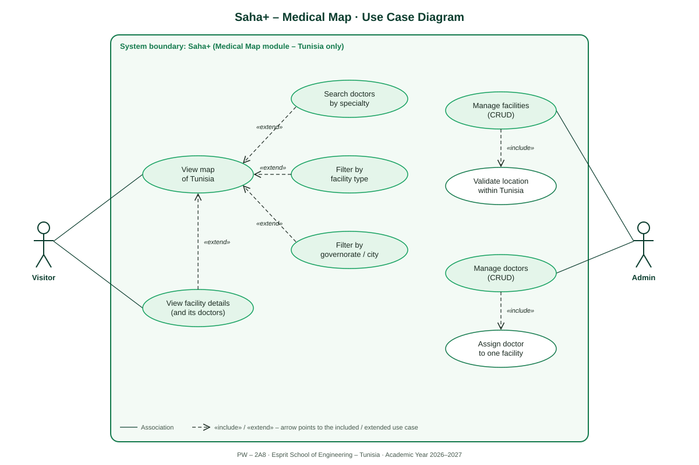
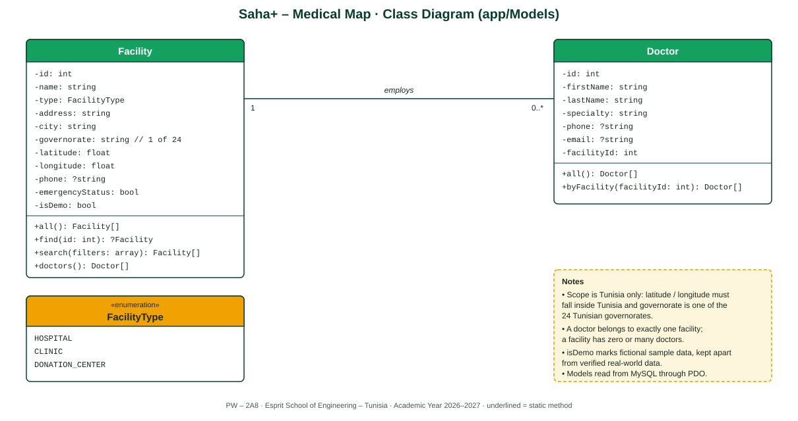

# Saha+ – Medical Map

Module of the **Saha+** platform (PW – 2A8, Esprit School of Engineering, 2026–2027).
Owner: **Rayen Mediouni**.

The Medical Map lets a visitor find hospitals, clinics, donation centers and their doctors on an interactive map. **Its scope is Tunisia only**, across the 24 governorates.

> **Demonstration data.** Every facility and doctor delivered with this module is fictional (`is_demo = 1`). They are not real establishments or practitioners. Phone numbers are empty and e-mails use the reserved test domain `example.com`.

## Features

**Front Office (visitor)**
- Interactive map of Tunisia (Leaflet), satellite or street background.
- One marker per facility, with a colour and letter per type: **H** hospital, **C** clinic, **D** donation center.
- Search doctors by specialty: only the facilities that have a matching doctor stay on the map.
- Filters by facility type, governorate and city. All filters combine.
- Details panel: name, type, address, city, governorate, phone, emergency status and the list of doctors.
- "No matching facility in Tunisia" message when nothing matches. Results from elsewhere are never suggested.

**Back Office (administrator)**
- Facilities: list, search, filter by type, add, edit, delete, location picker on a map.
- Doctors: list, search, filter by specialty, add, edit, delete, choice of the facility.
- Server-side validation of every form.

## UML

| Use case diagram | Class diagram |
|---|---|
|  |  |

Relationship: **Facility (1) — (0..\*) Doctor**. A doctor belongs to exactly one facility; a facility has zero or many doctors.

## Installation

Requirements: XAMPP (PHP 8.1 or newer, MySQL/MariaDB) and an internet connection (Bootstrap, Leaflet, fonts and map tiles are loaded online).

1. Put the repository in `C:\xampp\htdocs\` (or run the PHP built-in server, see below).
2. Start **Apache** and **MySQL** in the XAMPP control panel.
3. Open phpMyAdmin (`http://localhost/phpmyadmin`), tab **Import**, choose `app/feature-MedicalMap/database/medical_map.sql`, click **Import**.
   The script creates the database `saha_plus` and the tables `facility` and `doctor`. Importing it again resets these two tables only.
4. If your MySQL user is not `root` with an empty password, edit `config/database.php`.
5. Open the module:

| Page | URL |
|---|---|
| Medical Map (Front Office) | `http://localhost/Esprit-PW-2A8-2027-SahaPlus/app/feature-MedicalMap/index.php` |
| Facilities (Back Office) | `.../index.php?page=admin-facilities` |
| Doctors (Back Office) | `.../index.php?page=admin-doctors` |

Without Apache, from the repository root:

```bash
php -S localhost:8000 -t app
```

then open `http://localhost:8000/feature-MedicalMap/index.php`.

## Structure (PHP MVC)

```text
feature-MedicalMap/
├── index.php                  # entry point: reads ?page=, calls the controller
├── config/
│   ├── database.php           # MySQL settings
│   └── map.php                # tile providers and Tunisia bounds
├── database/medical_map.sql   # tables, constraints, demonstration data
├── app/
│   ├── routes.php             # page key => [Controller, method]
│   ├── helpers.php            # is_tunisian_phone(), text_length()
│   ├── Models/
│   │   ├── Database.php       # shared PDO connection
│   │   ├── Governorate.php    # the 24 governorates + limits of Tunisia
│   │   ├── Facility.php       # read, search, validate, create, update, delete
│   │   └── Doctor.php         # read, search, validate, create, update, delete
│   ├── Controllers/
│   │   ├── Controller.php     # render(), redirect(), flash messages, form token
│   │   ├── Front/MapController.php
│   │   └── Back/FacilityAdminController.php, DoctorAdminController.php
│   └── Views/
│       ├── layout_front.php   # Front Office shell (shared Saha+ partials)
│       ├── layout.php         # Back Office shell (shared Saha+ partials)
│       └── pages/front/, pages/back/
├── assets/css/, assets/js/    # map.css, map.js, admin.css, admin.js
└── docs/                      # UML diagrams, task list
```

**How a request travels:** `index.php` → `routes.php` → controller method → models (MySQL through PDO) → `render()` → page view placed inside a layout.

**Theme:** the module does not copy the UI kit. Its layouts include the partials and CSS of `app/shared/`, so it always follows the common Saha+ theme. The `app/shared/` folder must therefore be present next to this module.

## Tunisia-only rule

The rule is enforced at four levels, so it cannot be bypassed from the browser:

| Level | Where | What |
|---|---|---|
| Database | `medical_map.sql` | `CHECK` on latitude/longitude and on the governorate name |
| Model | `Governorate.php`, `Facility::validate()`, `Facility::search()` | list of the 24 governorates, limits of the country, search restricted to these limits |
| Controller | `MapController::data()` | an unknown governorate returns no result |
| Map | `map.js`, `admin.js` | the map cannot be dragged or zoomed away from Tunisia; the outside is darkened |

**Known limit:** the country is approximated by a rectangle (latitude 30.20–37.60, longitude 7.50–11.65). A point just across the border, inside this rectangle, is accepted. Following the real border would need a boundary file.

## Map background (tiles)

Leaflet is only the map library. The images come from a provider chosen in `config/map.php`:

| Key | Provider | Note |
|---|---|---|
| `satellite` (default) | Esri World Imagery | Attribution is displayed. Esri's terms for use without an account are not clearly documented: for anything beyond this school prototype, create a free ArcGIS developer account, or switch to `streets`. |
| `streets` | OpenStreetMap | Free for light use, attribution displayed. Used automatically if the satellite tiles fail to load. |

To change the default, edit `'default'` in `config/map.php`.

## Validation rules

| Field | Rule |
|---|---|
| Facility name | 2 to 120 characters |
| Type | hospital, clinic or donation center |
| Address, city | required |
| Governorate | one of the 24 |
| Latitude, longitude | numbers inside the limits of Tunisia |
| Phone (optional) | 8 digits, optionally preceded by `+216` |
| Doctor first/last name | 2 to 60 characters |
| Specialty | one of the list in `Doctor::SPECIALTIES` |
| E-mail (optional) | valid address |
| Doctor's facility | must exist |

A facility that still has doctors cannot be deleted: move or delete its doctors first.

## How to test

1. **Map:** open the Front Office. 36 markers appear over the whole country. Try to drag the map to Europe: it comes back.
2. **Specialty:** type `Dermatology`. 5 facilities remain. Click one: the dermatologist is highlighted in the panel.
3. **Combined filters:** type `Cardiology` and tick **Clinic**: 2 clinics remain.
4. **No result:** type `Astrology`: the "No matching facility in Tunisia" message appears.
5. **Add a facility:** Back Office → Facilities → Add facility. Leave the form empty and save: each field shows its message. Type latitude `48.85`, longitude `2.35` (Paris): refused.
6. **Relationship:** add a doctor to your new facility, then try to delete the facility: refused until the doctor is moved or deleted.

## Limits and next steps

- The Back Office has no login yet (no shared authentication in the project).
- The sidebar links to the other modules open a "Coming soon" page, because each module currently lives in its own folder.
- The shared home page still lists this module under the folder name `feature-HealthMap`; `shared/app/Models/Module.php` should point to `feature-MedicalMap`.
- Replace the demonstration data with verified data from an official source before any real use, and untick "Demonstration data" on verified facilities.

## Credits

- Map library: [Leaflet](https://leafletjs.com/)
- Tiles: Esri World Imagery, © OpenStreetMap contributors
- Theme: shared Saha+ UI kit (`app/shared`), Bootstrap 5

> Saha+ is an educational project. It does not replace medical professionals.
